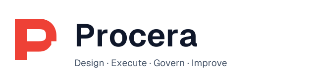

# Procera brand assets

Status: **Geometric identity v2 (2026-10-12)**. The product symbol is a flat, open-counter P with a stepped terminal. SVG masters replace the raster board extractions; trademark clearance remains outstanding (see [Production caveats](#production-caveats)). How the brand is applied in the product UI is normative in [docs/05 §7.1.1](../../docs/05-UX-AND-DESIGN.md).

  <picture>
    <source media="(prefers-color-scheme: dark)" srcset="logo/procera-logo-horizontal-dark.png">
    
  </picture>

## Brand copy

| | |
|---|---|
| **Name** | Procera |
| **Tagline** | Turn processes into progress. |
| **Supporting line** | Design · Execute · Govern · Improve |
| **Short description** | Procera is a modern, open-source business process management platform that helps organizations design, automate, govern, and continuously improve their business processes, end to end. |
| **Long description** | Procera combines process modeling, workflow automation, documentation, case management, compliance, and insights into a single, easy-to-use platform. It empowers teams to create and run efficient processes, maintain operational control, ensure compliance, and drive continuous improvement, with a focus on simplicity, flexibility, and open-source freedom. |
| **GitHub one-liner** | Open-source business process management for modeling, automating, governing, and improving workflows. |

**Pillars**

| Pillar | Meaning | Product areas |
|---|---|---|
| **Design** | Model and document processes | Library, SOPs, policies, designer, templates |
| **Execute** | Automate work across people and systems | Requests, approvals, forms, e-signing, announcements, integrations |
| **Govern** | Ensure compliance, control and visibility | Lifecycle and SoD, roles, audit trail, investigations, retention |
| **Improve** | Gain insights and continuously optimize | Dashboards, SLAs, process health, improvement proposals |

Writing rules:
- Always write **Procera**: capital P, never "PROCERA" in running text and never "ProCera".
- Product areas use plain words ("Policies", "My Work"), never "Procera Policies™".
- No superlatives we can't prove. The compliance wording rules in [docs/14](../../docs/14-DATA-GOVERNANCE-AND-COMPLIANCE.md) apply to marketing too.

## Colour palette

| Name | Hex | Role (see docs/05 §7.1.1) | On #FFFFFF | On #0F172A |
|---|---|---|---|---|
| Flamingo Red (Primary) | `#EE4136` | `brand`: logo, focus, active state, large display text | 3.86 (UI/large text only) | 4.63 |
| Coral (Primary Light) | `#FF6B5A` | Dark-theme links / accent text | 2.80 ✗ | 6.38 |
| Deep Red (Primary Dark) | `#C72D26` | Light-theme links; optional filled accent button | 5.48 | 3.26 ✗ |
| Charcoal (Text Primary) | `#0F172A` | Text, primary buttons, dark background | 17.85 | — |
| Slate (Text Secondary) | `#64748B` | Secondary text on white / light gray only | 4.76 | 3.75 ✗ |
| Light Gray (Background) | `#F8FAFC` | Page background; dark-theme text | — | 17.06 |
| White (Surface) | `#FFFFFF` | Panels, cards, light logo backgrounds | — | 17.85 |

✗ = below 4.5:1, so not allowed for normal-size text in that pairing.

**Key rule:** brand red is the brand signal, not the action colour. Primary buttons are charcoal. Destructive actions use a separate crimson (`#B42318`) together with an icon and words. The rationale is in docs/05 §7.1.1.

## Files

| Path | What | Use |
|---|---|---|
| `logo/procera-logo-horizontal.png` | Horizontal lockup with supporting line, light background | Docs and light backgrounds |
| `logo/procera-logo-horizontal-transparent.png` | Same, transparent | Light theme (README, site) |
| `logo/procera-logo-horizontal-dark.png` | White wordmark, transparent | Dark theme |
| `logo/procera-logo-stacked*.png` | Stacked lockup (light / transparent / dark) | Square placements, splash, login |
| `logo/procera-symbol.png` | Geometric P symbol, SVG master and transparent 256² | App shell, avatars, small placements |
| `logo/procera-symbol-on-light.png` | Symbol on light background | Where transparency isn't supported |
| `icons/app-icon-{light,dark,dark-alt,red}.png` | App icon tiles, padded square | App tiles, PWA 192/512 exports and store mock-ups |
| `favicon/favicon.ico`, `favicon/favicon-{16,32,48,64,128,256,512}.png` | Favicon set | Web app and docs site (`<link rel="icon">`, PWA icon exports and Apple touch icon are also generated) |
| `marketing/procera-banner.png` | 1523×175 dark banner with tagline | GitHub README header, social and site hero |
| `marketing/procera-tagline.png`, `-short-description.png`, `-long-description.png` | Copy cards | Presentations |
| `marketing/procera-color-palette.png`, `-monochrome-logos.png`, `-favicon-reference.png` | Current palette, monochrome and small-size sheets | Brand review |
| `source/` | Untouched originals from `Procera_Brand_Assets.zip` (incl. `BRAND_COPY.md`) | Provenance; don't edit |

The current logo, lockups, app icons and favicons are generated from the same geometric master by `scripts/build_brand.py` (`python3 -m pip install cairosvg pillow fonttools brotli`, then `python3 scripts/build_brand.py`). The product uses SVG directly, with a multi-resolution ICO fallback. The original `source/` board is historical provenance. All current marketing sheets now use the new identity. Wordmarks and supporting copy use the same Geist font shipped by the web app. Exported SVG lettering is outlined so it stays identical without installed fonts. Run `npm ci` in `web/` before regenerating.

## GitHub and delivery assets

The root README uses a theme-aware light/dark banner. `marketing/procera-social-preview.png` is a 1280×640 GitHub social preview: upload it in repository Settings → Social preview. `marketing/procera-brand-overview.png` shows the logo, dark version, app icons and favicon sizes. Marketing cards, palette and monochrome sheets are available as PNG and outlined SVG. Source boards are retained unchanged in `source/`.

## Logo usage

- **Clear space:** at least half the symbol's height on all sides.
- **Minimum size:** symbol 16 px. Horizontal lockup 120 px wide. Drop the supporting line below 240 px.
- **Backgrounds:** use the colour logo on white, `#F8FAFC` or light neutrals, and the dark variant on `#0F172A` or dark neutrals. Use monochrome where colour isn't possible: print, embossing, a single-colour screen.
- **Don't** recolour the symbol, stretch it, rotate it, add effects or shadows, place it on busy photos, or rebuild the wordmark in another font. Keep wordmarks in Geist, using the outlined master for exported lockups.

## Production caveats

1. **Vector masters.** Symbol and lockup SVGs now live alongside PNG exports. The favicon uses the same broad, open-counter geometry at 16–32 px; inspect raster exports whenever the master changes.
2. **Trademark and domain clearance** for "Procera" in target markets has **not** been performed. Tracked as **OQ-01** in [docs/22](../../docs/22-UNKNOWNS-ASSUMPTIONS-AND-OPEN-QUESTIONS.md). Other companies and products already use "Procera", so a search is required before public launch.
3. The palette was transcribed from the board. Verify it against the vector masters.
4. Licence: brand assets are **not** covered by the Apache-2.0 code licence. They are trademarks of CasualOffice. Use follows [GOVERNANCE.md §7](../../GOVERNANCE.md#7-trademark).
