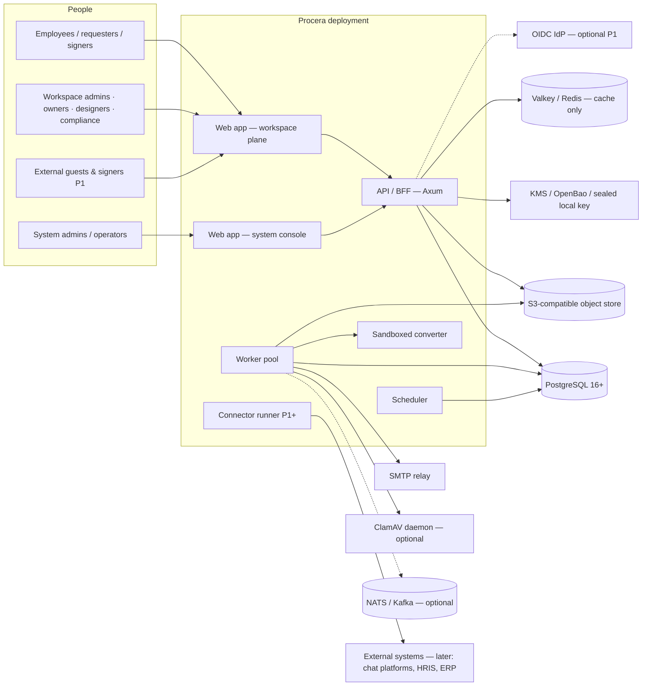
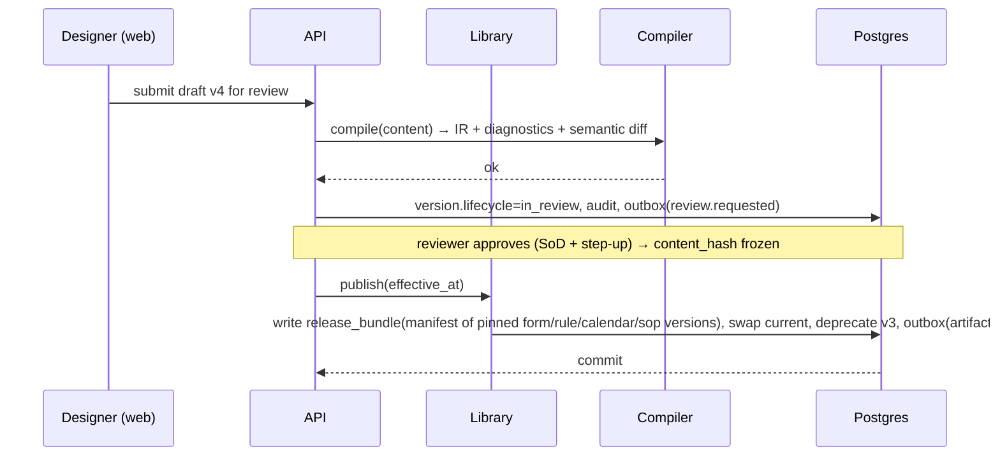

# 03 — High-Level Design (HLD)

Status: Draft v0.2 for G1 · Owner: Architect · Supersedes [v0.1](archive/v0.1/03_HLD.md).

## 1. System context



Only **PostgreSQL, an S3-compatible store and SMTP** are required, which is what standalone-first means ([ADR-0016](adr/ADR-0016-standalone-first.md)). Everything dotted is optional.

## 2. Planes and bounded contexts

```
┌──────────────────────── SYSTEM PLANE ────────────────────────┐
│ Workspaces lifecycle · Quotas · Platform settings & floors    │
│ Template gallery · Platform health · System audit · Break-glass│
└───────────────────────────────────────────────────────────────┘
┌────────────────────── WORKSPACE PLANE (tenant) ───────────────┐
│ Identity&Access  Directory  Settings                           │
│ Library (processes · SOPs · policies · forms · rules · calendars│
│          · document templates) + Governance lifecycle          │
│ Runtime (IR compiler · interpreter · scheduler)                │
│ Work (inbox · assignment · delegation · SoD)                   │
│ Campaigns (ack · quiz · sign · announcements · envelopes)      │
│ Cases & Investigations   Files   Notifications                 │
│ Insights (projections · SLA · dashboards · reports)            │
│ Audit (chain · explorer · checkpoints · exports)               │
│ Integrations (ports; adapters later)  AI assistance (optional) │
└───────────────────────────────────────────────────────────────┘
```

| Context | Owns | Publishes | Consumes |
|---|---|---|---|
| Identity & Access | users, sessions, memberships, roles, grants, delegations | `membership.*`, `access.changed` | directory changes |
| Directory | departments, groups, positions, manager graph | `directory.changed` | SCIM/HRIS (later) |
| Settings | workspace/scope settings, profiles | `settings.changed` | — |
| Library & Governance | artifacts, versions, reviews, bundles | `artifact.*` | settings, access |
| Runtime | instances, tokens, splits, timers, jobs, incidents | `instance.*`, `incident.*`, `sla.*` | `artifact.published`, work completions |
| Work | work items, candidates | `work.*` | `instance.*`, `access.changed`, `membership.deactivated` |
| Campaigns | campaigns, recipients, announcements, envelopes, signatures | `campaign.*`, `envelope.*` | `artifact.published`, `membership.activated` |
| Cases | cases, items, investigations | `case.*` | audit, files |
| Files | file objects, scan/preview state, retention | `file.*` | — |
| Notifications | intents, digests, templates | — | all of the above |
| Insights | projections, metric snapshots | — | all domain events |
| Audit | audit events, heads, checkpoints | — | synchronous append from every context |

All of these run in **one process image** (a modular monolith, [ADR-0007](adr/ADR-0007-modular-monolith.md)). Contexts talk through in-process application services for commands and through outbox events for reactions. Each context owns its tables, and nobody writes another context's tables. This is enforced by module visibility and a schema-ownership lint.

## 3. Runtime processes

| Process | Scale unit | Responsibilities |
|---|---|---|
| `api` | Stateless replicas behind LB | HTTP API, BFF for web, SSE for live updates (inbox counts, dashboards) |
| `worker` | Replicas; queue partitions by job kind | advance, service calls, notifications/email, campaign fan-out, envelope finalize, scans, previews, exports, projections |
| `scheduler` | 2+ replicas, lease-based (no single leader needed) | timers, SLA clocks, reminders, publish-at-effective-date, retention, checkpoints |
| `converter` | Isolated pods, no network | DOCX→PDF, previews, PDF stamping |
| `connector-runner` (P1+) | Isolated pods, egress via proxy | Connector actions |

For the single-node trial, `api`, `worker` and `scheduler` can run as **one binary** (`procera serve --all`).

## 4. Deployment topologies

| Topology | For | Components |
|---|---|---|
| **Trial** (Docker Compose) | Startups, evaluation | `procera` (all-in-one) + Postgres + Valkey + SeaweedFS + Mailpit (dev) / SMTP + optional ClamAV |
| **Standard** (Helm, 1 cluster) | SMEs, most self-hosters | api ×2, worker ×2, scheduler ×2, converter ×1, HA Postgres (CloudNativePG / managed), S3, Valkey |
| **Enterprise** (Helm) | MNCs | Above + NATS/Kafka adapter, dedicated-DB workspaces, OpenBao/KMS, OTel collector, multi-AZ, WORM bucket for audit |
| **Hosted SaaS** (ours, later) | Everyone | Enterprise topology per region; residency pinning (PRV-05) |
| **Air-gapped** (P1) | Regulated/public sector | Offline images + signed bundles, local model for AI (optional), no telemetry |

## 5. Key flows

### 5.1 Publish a process



### 5.2 Approve a work item (the hot path)

```mermaid
sequenceDiagram
  participant U as Approver
  participant A as API
  participant DB as Postgres
  participant W as Worker
  U->>A: POST /v1/work/{id}/decisions (Idempotency-Key, If-Match)
  A->>A: authn · CSRF · authz(work:complete) · step-up if required
  A->>DB: BEGIN; set_config(ws); lock instance → token → work item
  A->>DB: validate state/revision/SoD/form; write decision (+signature); token→ready; job(advance); event; outbox; audit
  A->>DB: COMMIT; NOTIFY
  A-->>U: 200 {revision}
  W->>DB: claim advance job (SKIP LOCKED, fence) → interpret next nodes → commit
  W-->>U: SSE: request progressed
```

### 5.3 Bulk policy signing (campaign)

```mermaid
sequenceDiagram
  participant HR as HR admin
  participant A as API
  participant W as Worker
  participant E as Employee
  HR->>A: create campaign(policy v7 PDF, audience=all, action=sign, deadline)
  A->>W: job: render+hash PDF once; fan-out recipients in batches
  W->>E: email + in-app "Sign Code of Conduct"
  E->>A: open ceremony → re-auth (mode) → sign (Idempotency-Key)
  A->>W: job: finalize envelope (stamp, certificate, PAdES P1) → lock file
  W->>HR: dashboard counters update; reminders/escalations via scheduler
```

### 5.4 Investigation

1. The audit explorer runs a query.
2. The investigator pins events, files and requests. Each pin is snapshotted and hashed.
3. Legal hold flags propagate to the referenced records.
4. The evidence bundle is exported as a signed manifest plus chain proofs, and can be checked with `procera-verify`.

## 6. Data ownership & storage

| Data | Store | Notes |
|---|---|---|
| All transactional state, events, audit, outbox | PostgreSQL | RLS on `workspace_id`; monthly partitions for events/audit |
| Files, previews, exports, signed PDFs, audit segments | S3-compatible | `ws/{workspace_id}/…` keys; per-file DEKs; WORM bucket optional |
| Cache, rate limits, SSE fan-out | Valkey/Redis (standard; in-process fallback for Trial) | Never authoritative ([ADR-0019](adr/ADR-0019-valkey-redis-cache.md)) |
| Search | Postgres FTS (+ optional Tantivy) | Policy-filtered |
| Secrets (connector creds, SMTP, AI keys) | KMS/OpenBao, or encrypted in DB under the platform key | Never in IR/logs |

## 7. Multi-tenancy (workspace isolation)

Isolation is layered and every layer is tested independently:
1. **Auth context.** The workspace comes only from a verified session or token.
2. **Repository API.** Every repository method takes a `WsCtx`. A CI lint (sqlx query metadata scan) fails any query on a workspace table that doesn't filter by `workspace_id`.
3. **Postgres RLS.** Forced on every workspace table. The app role has no BYPASSRLS. A missing context returns zero rows.
4. **Composite foreign keys.** These include `workspace_id`, so cross-workspace references are impossible.
5. **Crypto.** Per-workspace KEK. Object keys are prefixed by workspace, and signed URLs are bound to the workspace.
6. **Caches.** Keys are always prefixed with `ws:{id}`, and caches are per-workspace where possible.
7. **Background jobs.** These carry `workspace_id` and set the RLS context per job.

Noisy-neighbour controls: per-workspace rate limits, job-queue fairness (round-robin across workspaces when claiming), quotas, and per-workspace statement timeouts.

## 8. Consistency, reliability, failure behaviour

- **Atomicity.** A state change, its domain events, the outbox entry and the audit append commit in one transaction ([ADR-0005](adr/ADR-0005-outbox-idempotency.md)).
- **Side effects.** Email, connectors and webhooks happen only after commit, are at-least-once, and carry idempotency keys.
- **Leases.** Jobs and timers use SKIP LOCKED claims with fencing tokens, and a lease expiry triggers recovery.
- **Ordering.** Events are ordered per aggregate (instance, envelope, campaign). There is no global ordering promise.
- **Backpressure.** Limits apply per workspace and per connector, with a DLQ and incidents for poison jobs.
- **Time.** Everything is stored in UTC. Business time comes from versioned calendars pinned at creation.
- **Degraded modes.** If SMTP is down, in-app notifications still work and email is retried. If the scanner is down, files stay `pending` and aren't served (fail closed), and an alert fires. If the object store is down, uploads are rejected but the rest works.

## 9. Real-time UX

Server-Sent Events push updates for inbox counts, request progress, dashboard tiles and campaign counters. Each stream is scoped per session and workspace. Events carry only ids and counters, and the client re-fetches through authorized endpoints. If SSE isn't available, the client falls back to polling every 30 s.

## 10. Extensibility (later; designed now)

- Ports: `NotificationChannel`, `DirectorySource`, `IdentityProvider`, `ConnectorAction`, `InboundEvent`, `FileConverter`, `AiProvider`, `Bus`, `KeyProvider`, `Scanner` ([13](13-INTEGRATIONS.md)).
- Connectors run out-of-process with declared scopes and egress allowlists. The main process never runs untrusted code.
- The public REST API (OpenAPI 3.1), signed webhooks and a CLI give automation a stable surface ([08](08-API-SPEC.md)).

## 11. Engineering platform

| Area | Choice |
|---|---|
| Repo | Single monorepo `bpms/` (Rust workspace + `web/` pnpm workspace) |
| Rust | Stable toolchain pinned in `rust-toolchain.toml`; Axum, Tokio, sqlx (compile-time checked queries), serde, tracing, cedar-policy |
| Web | React + TypeScript (strict), Vite, TanStack Query/Table/Virtual, React Aria primitives, React Flow, ICU MessageFormat |
| CI gates | fmt, clippy `-D warnings`, tests (unit + testcontainers Postgres), conformance suite, cross-workspace sweep, audit-coverage contract, cargo-deny (licences/advisories), JS licence check, axe a11y, Playwright smoke, SBOM, image scan |
| Release | SemVer; signed images (cosign) + SBOM + provenance; Helm chart; upgrade test N-1→N |
| Docs | `docs/` design-first; public docs site later |

## 12. Capacity reference (hypotheses to validate)

These figures are the **reference load** used in every benchmark. They are targets, not claims.
- 100 workspaces, 50 000 members
- 10 000 waiting instances, 100 transitions/s burst
- 1 M historical instance events, 10 M audit events
- 5 000-recipient campaigns
- 100 concurrent admin grid users

The measurements come from spikes SP-01, SP-09 and SP-10 and from M10 load tests.
