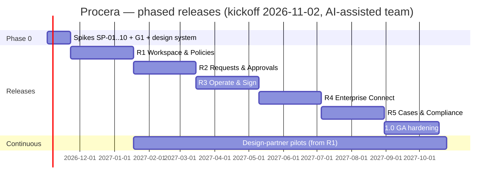

# 07 — Roadmap: phased releases, gates and delivery model

Status: Draft v0.3 · Owner: Product + Tech lead · Supersedes v0.2 (single-pilot plan) and [v0.1](archive/v0.1/07_DELIVERY_PLAN.md).
Every work item is in [17-EXECUTION-TRACKER](17-EXECUTION-TRACKER.md) and `trackers/Delivery_Tracker.xlsx`.

**What changed in v0.3 (owner direction):**
- Delivery uses **Claude Code and other AI coding agents**, so the human team is smaller and the timeline shorter.
- Work ships in **phases that are usable on their own**: the first usable release is about 11 weeks after kickoff, not about 9 months.
- Every release is gated by an **end-to-end test pack** ([23-E2E-TEST-PLAN](23-E2E-TEST-PLAN.md)).

> Dates are **indicative**, assuming kickoff **Mon 2026-11-02** and the team in §5. Every release has a measurable exit checklist. A slipped checklist item moves the date or cuts scope; it never lowers the bar.

## 1. Release strategy

Each release is a **complete, deployable product for a real audience**: installable via Docker Compose, upgradeable to the next release, and documented. Design partners start using R1 in production-like pilots and stay on the upgrade path.

```
Phase 0  ── Spikes + G1 ─────────────────────────────►  (W1–W3)
R1  "Workspace & Policies"    usable by: any org for policies, SOP library, announcements, acks, files, audit   (W11)
R2  "Requests & Approvals"    usable by: startups/SMEs for leave, expense, purchase, access, onboarding        (W19)
R3  "Operate & Sign"          usable by: SMEs/enterprises; full admin console, e-sign, DoA, all Wave-1 templates (W27)
R4  "Enterprise Connect"      usable by: MNCs; SSO/SCIM, scoped admins, webhooks/API, email approvals, guests   (W35)
R5  "Cases & Compliance"      usable by: regulated orgs; cases, investigations, legal hold, Part 11, reports   (W43)
1.0 GA hardening              load/HA/DR, pentest, a11y audit/VPAT, i18n, docs                                (W50)
Post-GA                        Chat platforms, HRIS/ERP, QES/Aadhaar, BPMN view/DMN, mining, AI agents (demand-gated)
```



| Release | Window | Ships ≈ | Gate | Maps to v0.2 work packages |
|---|---|---|---|---|
| Phase 0 | W1–W3 | 2026-11-20 | **G1** | M0, M1 |
| **R1** Workspace & Policies | W4–W11 | **2027-01-15** | G-R1 | M2, M3, M4 (part) |
| **R2** Requests & Approvals | W12–W19 | **2027-03-12** | G-R2 | M5, M6 (part) |
| **R3** Operate & Sign | W20–W27 | **2027-05-07** | G-R3 (≈ old G3 pilot) | M4 (rest), M6 (rest), M7 |
| **R4** Enterprise Connect | W28–W35 | **2027-07-02** | G-R4 | M8 |
| **R5** Cases & Compliance | W36–W43 | **2027-08-27** | G-R5 | M9 |
| **1.0 GA** | W44–W50 | **2027-10-15** | G4 + G5 | M10, M11 |

Compared with v0.2, GA moves about 9 weeks earlier, from Dec 2027 to Oct 2027. The bigger change is that **the product is usable from Jan 2027** rather than from a mid-2027 pilot.

## 2. Release contents and exit checklists

Every release must also pass the **always-on gates**: its E2E pack and all earlier packs green (23), the cross-workspace sweep, audit coverage, axe a11y, licence/SBOM, an upgrade test from the previous release, and zero open critical/high security defects.

### Phase 0: spikes and G1 (W1–W3)

**Scope.** Parallel agent-driven spikes SP-01…SP-10 (reports in `docs/spikes/`). In parallel, run 8–12 interviews and model the 5 reference processes in the IR. Build design tokens and the core components, and set up the monorepo with CI gates and the E2E harness skeleton (Playwright + Compose + Mailpit + ClamAV).

**Exit (G1):**
- [ ] ADR-0010, 0011 and 0015 accepted.
- [ ] IR v1 frozen.
- [ ] Visual direction approved.
- [ ] Threat model reviewed.
- [ ] E2E harness runs one smoke test in CI.

### R1: "Workspace & Policies" (W4–W11)

**For:** any organisation that needs a governed policy/SOP library, announcements and proof of acknowledgement, with no workflows yet.

**Scope:**
- System console: bootstrap, workspaces, quotas, health, system audit.
- Local auth with MFA and step-up; sessions.
- Members, departments, groups, positions, CSV import.
- Built-in role templates plus custom roles with preview (Cedar).
- Settings layering, floors and profiles.
- Shared DataGrid with saved views and export.
- Library: collections, SOPs and policies on the full lifecycle with SoD, block editor, semantic diff, renewal dates, verification badge, PDF export, employee policy portal.
- Campaign engine (ack, new-joiner enrolment, evidence export).
- Announcements (targeting, schedule/expiry, required ack, approval, analytics).
- Files pipeline (upload, scan, quarantine, preview image/PDF, signed URLs, Files view).
- Audit chain, audit explorer and timelines.
- Workspace overview dashboard, people & access monitor.
- In-app + email notifications and digests; Valkey cache.
- Templates: policy-acknowledgement packs (Code of Conduct, InfoSec, POSH/anti-harassment, leave policy).

**Exit:**
- [ ] E2E pack **E2E-R1** green (J0 onboarding-to-ack, J12 startup day-one, J14 announcement, the custom-role journey, files, audit timeline, cross-workspace denial).
- [ ] A design partner publishes 3 policies and runs an ack campaign for ≥ 50 people on mobile.
- [ ] Usability: 5 users; ≥ 80 % complete the ack untrained.

### R2: "Requests & Approvals" (W12–W19)

**For:** startups/SMEs automating everyday approvals.

**Scope:**
- IR compiler; interpreter (task, approval, decision, parallel, timers, set, end).
- Jobs, timers and scheduler; SLA clocks on business calendars.
- Work items with assignment strategies (manager chain, quorum, per-group); delegation and out-of-office; SoD re-check; send-back; rule tables; incidents with retry.
- Form builder: typed fields, validation, calculations, prefill, repeating sections, file fields.
- Step builder with canvas, keyboard authoring and test run.
- Request portal, start form, request detail with comments, @mentions and watchers.
- My Work 3-pane inbox (tasks + acks).
- Template gallery and install wizard; first 6 templates: leave, expense claim, purchase requisition, access request, employee onboarding, policy exception.
- Conformance suite and nightly chaos runs.

**Exit:**
- [ ] **E2E-R2** green (J1 onboarding, J3 purchase thresholds, J7 out-of-office, double-approval race, restart mid-transition, 30-day timer via test clock).
- [ ] Conformance 100 %.
- [ ] A design partner runs ≥ 2 live processes for 2 weeks.

### R3: "Operate & Sign" (W20–W27)

**For:** SMEs and enterprises that need to run and watch processes at scale, plus employee e-signing.

**Scope:**
- Full admin console: all requests, all work and workload, process health, ops monitor, bulk actions with preview, alerts v1.
- DoA approval matrix; master-data tables.
- Recall, edit-after-submit, request-on-behalf; request numbering.
- E-sign v1: PDF, signer/approver/CC roles, sequential/parallel/mixed routing, bulk send, field placement, consent step, "not e-signable" flag, ceremony, certificate of completion.
- Remaining Wave-1 templates (13 total); BPMN 2.0 import with compatibility report.
- PWA at 360 px; retention policies.
- Formal pilot review (the old G3): SUS and time-to-first-process measured.

**Exit:**
- [ ] **E2E-R3** green (J9 admin monitoring, J11 file lifecycle, J13 bulk signing at 1 000 recipients, DoA routing, recall/edit-after-submit, mobile viewport pack).
- [ ] SUS ≥ 80 (requesters/approvers) and ≥ 70 (designers).
- [ ] Time to first published process ≤ 30 min (≤ 15 min on Starter).

### R4: "Enterprise Connect" (W28–W35)

**For:** MNCs.

**Scope:**
- OIDC SSO per workspace, SAML via broker, SSO enforcement, JIT; SCIM 2.0.
- Scoped/delegated admins; IP allowlists; sandbox workspace and config promotion.
- Webhooks (Standard Webhooks), HTTP connector via egress proxy, inbound events.
- Public API, OpenAPI, CLI, TS/Python SDKs.
- Email-actionable approvals, reply-by-email, web push.
- Guests and external signers (magic link + OTP), self-serve signing links.
- E-sign v2: DOCX and merge fields, anchor tags, conditional fields, delegate, correction, embedded signing.
- Public forms, save & resume.
- Subprocesses, reusable sub-flows, duplicate detection, bulk import.
- Auto-generated process documentation; policy templates; emergency alerts and moderation; quizzes.

**Exit:**
- [ ] **E2E-R4** green (SSO login and deprovision via SCIM < 5 min, scoped admin cannot escalate, webhook signature + replay rejection, email-approval replay rejection, external signer flow, SSRF denial).

### R5: "Cases & Compliance" (W36–W43)

**For:** regulated organisations and HR/compliance teams.

**Scope:**
- Cases: types, queues, macros, SLAs, link/merge, restricted cases.
- Investigations: pinned evidence, legal hold, signed export, conflict-of-interest check.
- Audit checkpoints, RFC 3161 timestamps, WORM export, `procera-verify`.
- Attestations and access reviews; retention disposition and DSAR.
- Part 11 mode, PAdES-LTV, TSA, kiosk signing.
- Alert centre, custom dashboards, report builder, scheduled reports, KPI goals, usage analytics, CSAT.
- Separation mode and break-glass; training paths.
- AI assistance (optional, off by default).

**Exit:**
- [ ] **E2E-R5** green (J4 incident case, J10 investigation with offline-verified export, legal hold blocks deletion, Part 11 re-auth, restricted case invisible in search/reports/notifications, break-glass visible to workspace).

### 1.0 GA hardening (W44–W50)

**Exit (G4/G5):**
- [ ] Reference load met; HA failover drill; RPO/RTO restore drill.
- [ ] External pentest with 0 critical/high; ASVS L2.
- [ ] WCAG 2.2 AA audit; VPAT.
- [ ] 3 UI languages, RTL.
- [ ] Helm, air-gapped bundle; upgrade from R1 → 1.0 with live data.
- [ ] Docs site and trust pack.
- [ ] Full E2E regression (all packs, 3 browsers) green.
- [ ] Signed release, SBOM, provenance.

## 3. Delivery model with AI coding agents

AI agents (Claude Code and others) write most of the implementation code, tests and docs under strict guard-rails. Humans own the decisions, the reviews and everything that needs judgement or accountability.

| Humans own | Agents do (under review) |
|---|---|
| Product decisions, design direction, ADRs, threat model | Implement tracker items against the LLD/IR/API specs |
| Code review of every PR (mandatory, CODEOWNERS on `runtime/`, `access/`, `audit/`, `infra/pg/`, crypto) | Unit, property, integration and **E2E tests** written alongside each feature |
| Security review, pentest triage, crypto/key handling sign-off | Migrations (expand/contract), OpenAPI annotations, fixtures, template packages |
| UX research, usability sessions, visual QA, a11y manual checks (screen reader) | First-pass a11y fixes from axe; i18n extraction; docs updates |
| Release go/no-go at each gate | Spike prototypes (Phase 0) in parallel worktrees |

Guard-rails that make agent output trustworthy:
1. **Spec-first.** Every task links to a PRD/catalogue id and the doc section. Agents may not invent behaviour: if the spec is silent, they add an entry to the register (22) and stop.
2. **CI is the referee.** fmt, clippy, cargo-deny licence gate, sqlx offline check, unit/property tests, conformance suite, cross-workspace sweep, audit-coverage contract, axe, Playwright E2E, SBOM. No merge on red.
3. **Small PRs.** At most ~400 changed lines, unless generated. One tracker item per PR.
4. **Protected areas.** Runtime interpreter, authz/Cedar compiler, audit chain, crypto/KMS and RLS migrations need two human approvals, plus a property test or E2E test proving the change.
5. **Agent instructions** live in `CLAUDE.md` and `AGENTS.md` (same contract for every tool) and are kept current.
6. **Parallelism.** Independent tracker items run in parallel agent sessions on separate branches or worktrees. The tech lead sequences merges along the critical path (§6).

**What AI does *not* speed up** (and why the plan keeps these durations): interviews and usability rounds, design-partner feedback cycles, security and pentest, accessibility audits, legal review (e-sign posture, APQC licence), and soak time for runtime correctness (nightly chaos needs weeks of runs).

## 4. Phase-level E2E gates (summary)

| Gate | E2E pack | Minimum |
|---|---|---|
| G1 | Harness smoke | 1 test, Compose up, Mailpit and ClamAV wired |
| G-R1 | E2E-R1 (+ smoke) | All R1 scenarios × Chromium; mobile viewport for ack/announcement |
| G-R2 | E2E-R1…R2 | + Firefox; race/restart/timer scenarios |
| G-R3 | E2E-R1…R3 | + WebKit; bulk-sign 1 000; admin bulk actions |
| G-R4 | E2E-R1…R4 | + SSO (Keycloak container), SCIM, webhooks |
| G-R5 | E2E-R1…R5 | + investigations, legal hold, Part 11 |
| G5 (GA) | Full regression | All packs × 3 browsers × 2 viewports; cache-off run; upgrade-path run |

## 5. Team (AI-assisted)

| Role | People | Notes |
|---|---|---|
| Tech lead / architect | 1 | Owns ADRs, merge sequencing, protected-area reviews |
| Senior Rust engineers | 2 | Runtime + platform/security; review agent PRs; write the hardest parts |
| Senior frontend engineers | 2 | Design system, DataGrid, designer/forms, signing UI |
| Product designer | 1 | Visual direction, screen specs, usability sessions |
| QA / SDET | 1 | Owns the E2E harness, test data, flake budget, release regression |
| DevOps / SRE | 0.5 | CI, Compose/Helm, observability, DR drills |
| Product manager | 0.5–1 | Tracker, design partners, gates |
| Security engineer | 0.25 + external pentest | Threat model, reviews |
| Domain SMEs (HR, Finance, IT, Compliance) | part-time | Template reviews |

That is **about 8–9 people plus AI agents**, compared with about 16 in v0.2 Option A. If the team is smaller, for example 1 Rust + 1 frontend + tech lead, keep the release order and stretch each release from 8 to 11–12 weeks. R1 still ships within about 4 months.

## 6. Critical path and dependencies

```
G1 ─► Identity/Tenancy/Access/Audit/DataGrid (R1 core, W4–W7) ─► Library+Campaigns+Announcements (R1, W6–W11)
G1 ─► Expression engine ─► IR compiler ─► Interpreter/Timers (R2, from W8 in parallel) ─► Forms/Designer ─► Templates
Campaign engine (R1) ─► E-sign (R3) ─► Attestations/Part 11 (R5)
Files (R1) ─► E-sign (R3) ─► Evidence/Investigations (R5)
Outbox (R1) ─► Notifications (R1) ─► Webhooks/Connectors (R4)
```

The runtime core starts in **W8**, in parallel with the second half of R1, so that R2 has a full 12 weeks of runtime work behind it.

## 7. Pre-agreed scope cuts (per release, if a release slips)

- **R1:** quiz → R4; DOCX import → R4; grouping in grid → R3.
- **R2:** parallel gateway → R3 (keep sequential/decision/timers); 6 → 4 templates.
- **R3:** office previews → R4; BPMN import → R4; mixed routing → R4.
- **R4:** SDKs → GA; reply-by-email → GA.
- **R5:** report builder → post-GA (fixed reports stay); kiosk signing → post-GA.

**Never cut:** isolation tests, audit coverage, the conformance suite, the E2E pack for shipped features, the a11y gate, security review, upgrade tests.

## 8. Release mechanics

- Semantic versioning: R1 = `0.1.0` … R5 = `0.5.0`, GA = `1.0.0`.
- Every release ships a Compose file, a Helm chart (from R3), signed images, an SBOM, release notes, an upgrade guide and its E2E report.
- **Upgrade guarantee:** each release upgrades in place from the previous one with live data (tested in CI), so design partners never re-install.
- After GA: a minor release every 6 weeks, and an LTS every 12 months.

## 9. Top risks (full register in the tracker)

| ID | Risk | Sev | Mitigation |
|---|---|---|---|
| R1 | Execution correctness | Critical | IR spec, conformance, property tests, chaos; protected-area reviews |
| R2 | Scope creep | High | Catalogue change process; per-release cut list |
| R3 | Cross-workspace leak | Critical | Forced RLS, CI sweep, E2E denial tests, pentest |
| R4 | UX quality / adoption | High | Usability every release; design-partner pilots from R1 |
| R16 | **AI-generated code quality / subtle bugs** | High | Spec-first tasks, small PRs, CI gates, 2-human review on protected areas, E2E per feature |
| R17 | **E2E flakiness slows releases** | Medium | Deterministic test clock, seeded data, retries limited to 1, flake budget owned by SDET, quarantine lane |
| R10 | Staffing | High | Release order is fixed; stretch durations instead |
