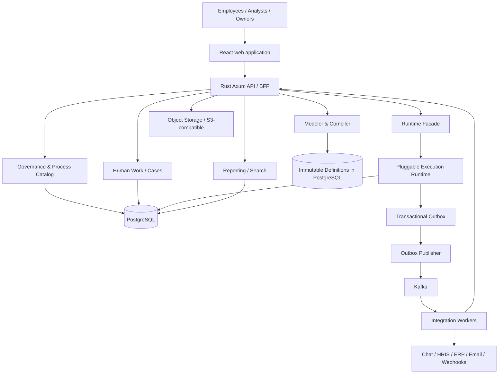

# High-Level Design (HLD)

## Context and boundaries

## Logical modules (initial modular monolith + separately scalable workers)
1. Identity & Policy: principals, tenant context, SSO/SCIM, role and attribute policies.
2. Process Landscape: catalog, ownership, taxonomy, maps and relationships.
3. Document & SOP: content, review/approval, evidence and retention.
4. Modeler: friendly flow JSON, typed graph validation, BPMN import/export, IR compiler.
5. Registry: immutable process definitions, release channels, effective dates, migration plans.
6. Runtime: state machine, jobs, timers, correlation, joins, cancellation and compensation.
7. Human Work: inbox, forms, assignments, delegation, escalation and decision signatures.
8. Case Management: case file, discretionary work, milestone tracking.
9. Integrations: connector registry, secrets, webhook validation, throttling, retries.
10. Insights: events, projections, metrics, conformance and improvement initiatives.
11. Audit & Compliance: immutable application audit, retention/legal hold and evidence export.

## Data ownership
PostgreSQL stores definitions, version pointers, runtime state, task state, tenant-scoped events, audit and transactional outbox. Object storage holds attachments/evidence (metadata and hashes in DB). Redis is optional for rate limiting/caches, not authoritative runtime state. Kafka delivers integration events; consumers deduplicate. Search initially PostgreSQL full-text, external search only after measurement.

## Runtime design alternatives
- **Rust native**: version-pinned IR interpreter, transactionally persisted tokens and wait states. Best packaging and product control; greatest correctness work.
- **Operaton/Flowable**: JVM BPMN engines behind adapter, app owns governance and UI. Best early standards depth; multi-runtime operations.
- **Temporal**: Rust SDK for durable activity orchestration, app compiles IR into versioned workflow handlers. Requires careful deterministic replay/version compatibility and mapping dynamic definitions to code.
Decision gate: benchmark all against functional conformance matrix, 30-day suspended workflows, recovery, cost and operations. Do not assume engines can be switched without data migration; adapter is a design seam, not free portability.

## Core execution lifecycle
Draft model -> validate -> review -> immutable publish -> instance start (pinned definition) -> node activation -> task/job/timer -> completion signal -> transactional state transition -> outbox -> projection/integration -> completion/termination.

## Multi-tenancy and authorization
Every row includes tenant_id; tenant-bound foreign keys; RLS defense-in-depth if feasible, with mandatory `SET LOCAL` scoped to transaction and test coverage. Tenant IDs derive from verified auth context, never user-supplied header. Separate policy checks for process visibility, instance participation, form fields, attachments, delegation and audit exports. Object storage keys and signed URLs are tenant-bound.

## Deployment topology
Compose (single-node trial): web, API, worker, scheduler, PostgreSQL, optional Redis, object storage, broker adapter. Production: load-balanced API replicas; worker pools separated by integration type; scheduler with DB leases; HA PostgreSQL, durable broker, replicated object storage, telemetry. Keep stateless APIs and idempotent worker jobs.

## Consistency and failure behavior
Process state changes and outbox inserts commit atomically. Worker uses claim/lease with fencing or transactional lock; lease expiry allows recovery. External side effects are at-least-once, never promise exactly-once; use idempotency keys and compensation when needed. Separate domain event ordering by process_instance_id. Backpressure per tenant/connector. Timers persisted with UTC instants and timezone-aware business calendar rules.

## Extensibility
Public versioned REST APIs + signed webhooks; connector SDK with declared scopes and capabilities; no untrusted executable plugins inside main API process. Use sandboxed connector workers and egress allowlists. Event schemas use schema_version and compatibility policy.

## Capacity planning (hypotheses to test)
Define target: 100 tenants, 10k waiting instances, 100 transitions/sec burst, 1m historical events. Load-test API, DB indexes, outbox lag, scheduler drift, Kafka consumer lag and object storage separately. These are benchmark scenarios, not proven capacity claims.
